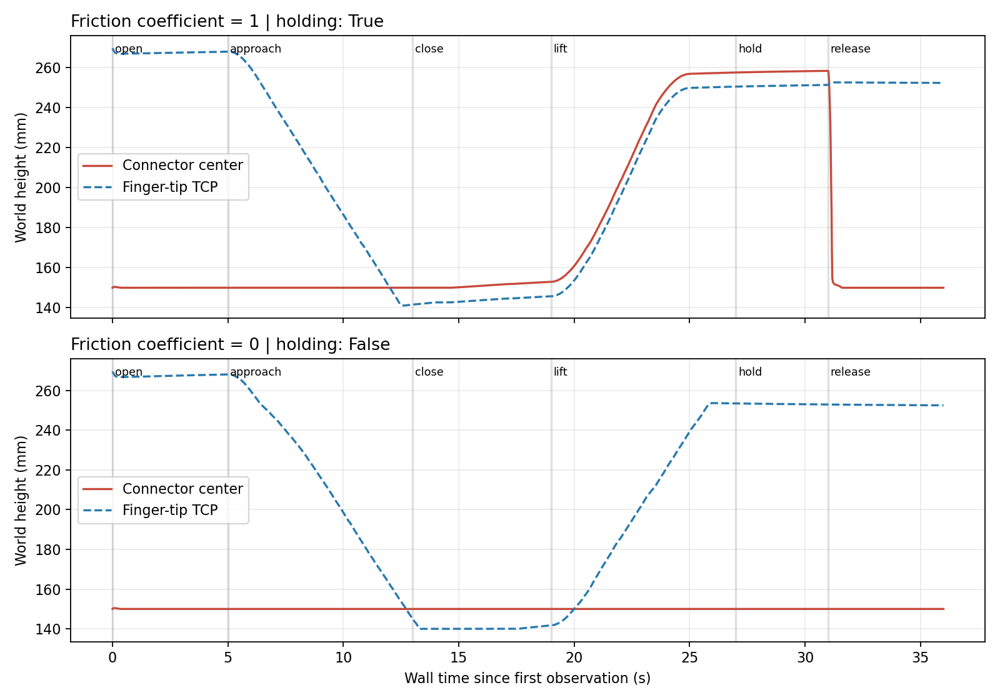

# 柔軟ケーブル付き端末の接触把持

双腕モデルと同じ直動指で、摩擦接触による把持・持ち上げ・解放を確認した。経路制御や画像認識から切り分けるため、既知位置の端末に対して垂直に動く試験治具を用いる。MELFAアームでランダム配置のハーネスをつかんだ結果ではない。

## 実行

```bash
docker compose run --rm dev python3 scripts/grasp_benchmark.py \
  --output outputs/contact_grasp_positive

docker compose run --rm dev python3 scripts/grasp_benchmark.py \
  --output outputs/contact_grasp_negative --friction 0 --expect-slip

docker compose run --rm dev python3 scripts/plot_contact_benchmark.py \
  --output docs/evaluation/contact_grasp
```

両試験は順番に実行する。同じROSドメイン175を使用し、Gazeboの区画は試験ごとに分ける。CLIは期待と一致すると正常終了する。摩擦ゼロの`success: false`は物理的に保持しなかったという意味で、`expectation_met: true`が比較試験の合格を表す。

## シーンと判定

- 指の形状・直動関節・制御ゲインは双腕モデルと共通。指の接触面の摩擦係数を1または0に変更する。
- 40×20×20 mmの端末、12個の25 mm剛体ケーブル片、曲げばね・減衰付きuniversal関節、分岐元の塊を使用。合計質量は設定上93 g。多端末ハーネス生成処理の1枝を使う。
- ピンはこの試験では取り除き、ハウジングが台に載った既知姿勢から始める。画像認識は使わない。
- 開く→下降→閉じる→約100 mm上昇→4秒保持→開いて解放する。指とハーネスの固定ジョイント、瞬間移動、リンクの追従処理はない。
- Gazeboの独立した姿勢情報とROSの指関節位置を受信する。動くモデルの座標も毎回変換する。古いフィードバックは受理しない。

保持は端末と工具がともに70 mm以上上がり、保持中の相対移動と閉じた時点からの相対ずれが5 mm以内、両指が空の閉位置から0.8 mm以上離れて止まっていることを条件とする。10件以上の保持観測を必要とする。解放後の下降が30 mm以上あることも確認する。接触力そのものを計測した判定ではない。

## 結果（2026-10-11）

| 試験 | 端末の最小上昇量 | 閉じた時点からの最大相対ずれ | 解放後の下降 | 保持判定 |
| --- | --- | --- | --- | --- |
| 指の摩擦係数1 | 107.4 mm | 0.204 mm | 108.2 mm | 成功 |
| 指の摩擦係数0 | 約0 mm | 111.7 mm | 約0 mm | 失敗を検出 |

摩擦ありでは両指の残り移動量が約1.98 mmとなり、20 mm幅の端末との接触で止まった。保持中のケーブルの高さの範囲は約113〜114 mmで、台に残った部分と持ち上がる部分の変形を確認した。摩擦ゼロでは指だけが上昇し、端末は台に残った。

[摩擦ありの記録](evaluation/contact_grasp/positive_validation.json)、[摩擦ゼロの記録](evaluation/contact_grasp/negative_validation.json)と10 Hz以下へ間引いた軌跡CSVを保存した。全軌跡、生成URDF・SDF、ログは各`outputs/`フォルダに残る。



41件の単体テストを通過。工具だけの上昇、端末だけの上昇、空の閉指、持ち上げ中・保持中の滑り、観測不足を成功と判定しないこと、動くモデル座標の変換を含む。初期試行では工具の固定フレームを追っていたため、動くモデルとリンクの姿勢を合わせて追う方式に修正した。初期試行は合格記録に含めない。

摩擦・慣性・曲げばねは試作値で、実材料の校正や接触力・張力の検証は未実施。直動治具の下降には過渡誤差があり、精密な把持点への到達を証明する試験でもない。次は画像からの把持候補とMELFA制御へ接続し、ランダム配置・複数端末・もう片腕の支持を検証する。
