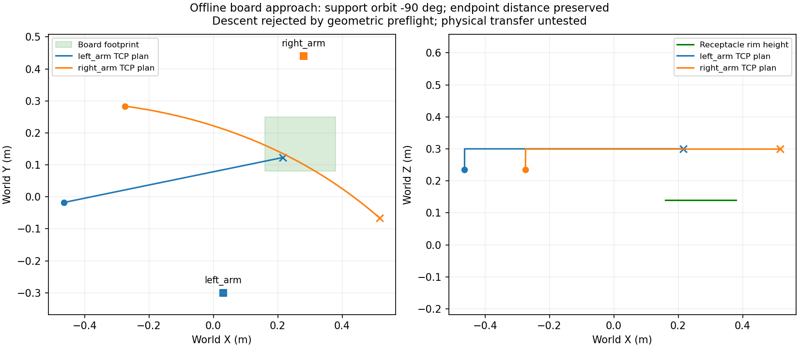

# 双腕で基板上方へ搬送する経路の事前評価

2026-10-11。D101／配置seed2／左腕P1・右腕P3の[把持成功記録](cooperative-pickup.md)から、P1を図面で指定されたJ2の上方へ運ぶ経路を評価しました。今回はオフラインのIK・幾何検査です。Gazeboでハーネスを搬送した実績や挿入成功ではありません。

## 結果

高さ0.30／0.40／0.50 m、並進と回転の順序、支持端子の動かし方を組み合わせた36候補を検査しました。4候補が基板上方まで通過し、その4候補すべてで着座位置への下降が治具の包絡箱検査により拒否されました。

選択した候補は、TCPを約0.30 mまで上げ、主端子をJ2上方へ移動・姿勢合わせしながら、支持端子を主端子の周りに世界Z軸で−90°回り込ませる経路です。右腕の端子の向きは世界座標で維持します。ワイヤーの変形を許容する幾何学的候補として、両TCP間の距離を維持します。

| 項目 | 計画上の値 |
|---|---:|
| 移動・姿勢合わせのウェイポイント | 各腕140点 |
| 両TCP間距離の最大変化 | 0.168 mm |
| 両TCP間の最小距離 | 355.359 mm |
| 移動区間の干渉検査 | 408サンプル |
| 包絡箱の余裕 | 各箱5 mm |
| 基板上方まで | 双腕・固定治具の検査を通過 |
| 着座位置への下降 | 不成立：左前腕の包絡箱と基板が重なる |

距離の数値はFKから求めたTCPの値であり、物理シミュレーションで観測した端子間距離や張力ではありません。支持側の姿勢を自由にした経路では、端子間の相対姿勢は変化します。



## 実装と再現

`cooperative_transfer.py`が位置とSO(3)姿勢の補間、双腕IK、関節角の連続性、関節補間中の端子間距離の検査を担当します。既存の双腕包絡箱検査に加え、`fixture_collision_bounds.py`がSDFの固定作業台・基板・受け側コネクタの箱を世界座標に変換して検査します。

```bash
docker compose exec -T gui python3 scripts/plan_transfer.py \
  --source docs/evaluation/melfa_dual_pick_seed2 \
  --output outputs/transfer_study.json --require-descent
```

今回のデータでは、`hover_success=true`、`descent_success=false`を保存して終了コード1になります。`--require-descent`を外すと、上方への経路が得られた場合に終了コード0となります。`success`はレポートの`stage=offline_board_hover`に対する判定です。

[検査結果](evaluation/melfa_transfer_seed2/report.json)には36候補の判定、選択経路の関節角、下降の拒否箇所、入力資料とURDFのSHA-256を保存しました。開始関節角は成功記録の名目上の持ち上げ終点です。ライブの関節角・画像を使う制御への統合はまだ行っていません。

## 挿入位置と次の実装

受け側の縁は基板設計の`origin_m[2]`です。端子ハウジングは厚さ20 mmのため、着座時の中心は縁から10 mm上、ピン先端は中心から50 mm下となります。把持時の端子とTCPの相対変換を使い、図面の接続先座標・yawから上方待機姿勢と着座姿勢を計算します。

今回の下降では約66%地点で左前腕の包絡箱が基板と重なりました。包絡箱は保守的な近似であり、実際のメッシュ同士の接触を確認した結果ではありません。また、全ての可能な経路が不可能と証明したわけではありません。次は上から挿入できる把持姿勢への持ち替え、または別の連続IK枝を検討し、下降可能な経路を得てから実行へ統合します。

自己衝突、動く搬送台、端子・ケーブルと設備の接触、ワイヤーの張力・ねじれ、挿入時の力制御はこの検査に含まれません。端子間距離の維持だけではケーブルの引っ掛かりや保持を保証できません。物理搬送、全3端子の接続、直接のワイヤー支持は引き続き未完了です。

姿勢の180°補間、支持側の到達不能・関節角飛びの拒否、支持端子の回り込み、間隔変化の検出、治具座標の合成と途中衝突の検出を含め、70件の単体テストが通過しました。
