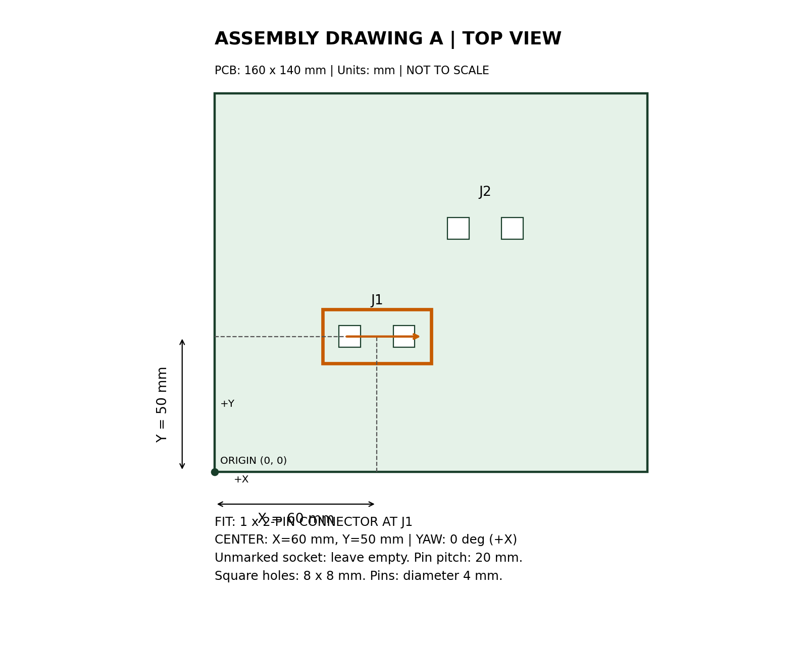
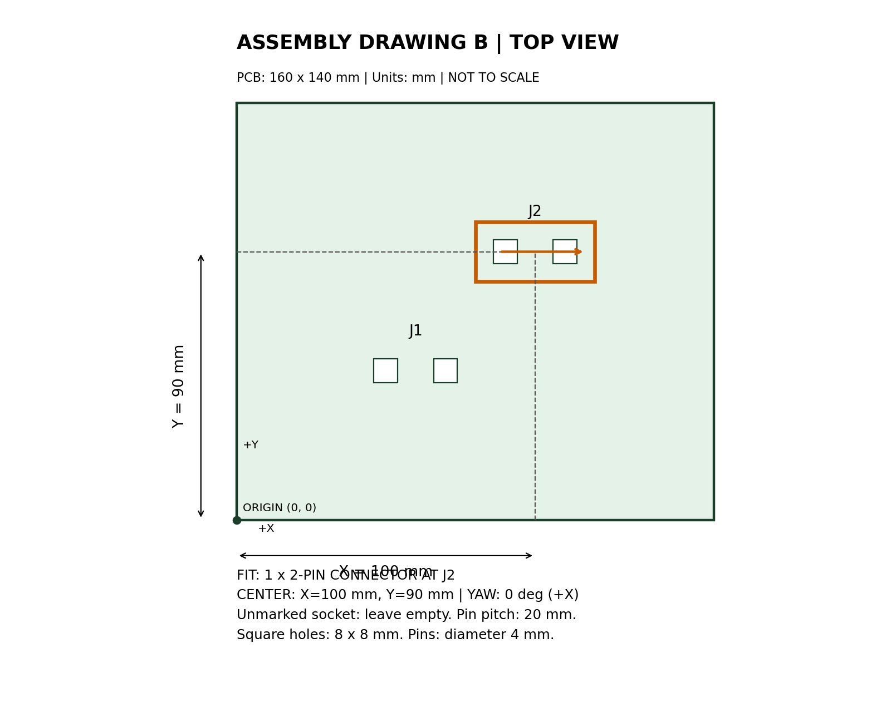

# 図面A・Bによる挿入位置の切り替え

同じ部品・基板・直交型ロボットを使い、作業指示を変更して挿入位置を切り替える。

| 組立図 | 挿入箇所 | 部品中心X | 部品中心Y | 向き |
|---|---|---:|---:|---:|
| A | J1 | 60 mm | 50 mm | 0° |
| B | J2 | 100 mm | 90 mm | 0° |

各図面は部品1個を要求する。指定されていないソケットは空けておく。基板は共通の簡略治具で、両方の穴がある。品種による実装位置の変更を示すデモであり、基板形状そのものの自動生成は行わない。

## 図面





PNGはモデルへの入力、SVGは拡大・編集用。部品番号、座標寸法、向き、個数、空けておく箇所を記載する。実際のシミュレーションと同じ8 mm角の穴を表す。

図面の生成元は`scripts/build_drawings.py`。基板の形状・穴の位置の生成元は`scripts/build_world.py`で、共通の`configs/board.json`を使う。ロボット実行コードは図面A・Bで共通。

## 手書き指示での基礎確認

```bash
docker compose run --rm dev python3 scripts/run_insertion.py --task examples/task_a.json
docker compose run --rm dev python3 scripts/run_insertion.py --task examples/task_b.json
```

各実行は新しいシミュレーションを開始するため、新しい基板と部品を供給した状態になる。組立済み部品をテレポートさせて移し替える処理はない。

結果は`outputs/result_J1.json`と`outputs/result_J2.json`に保存する。各ファイルはその箇所の最後の成功結果で、直近の実行の成否は`outputs/insertion_result.json`を確認する。

## 画像からの指示生成

[ローカルAIの手順](local-ai.md)で図面画像から作業指示を生成し、`--task outputs/ai_task_a.json`などを指定する。正解JSONは読解の評価に使い、モデルへの入力には含めない。

## 検証（2026-10-10）

手書き指示でA・Bとも挿入に成功。Aの部品中心は(0.25, 0.15, 約0.13) m、Bは(0.29, 0.19, 約0.13) m。いずれも解放・退避後に確認し、ピン先端の挿入深さは約40 mm。

ローカルモデルの画像読解結果によるA・Bの挿入も成功。[検証記録](validation.md)を参照。
