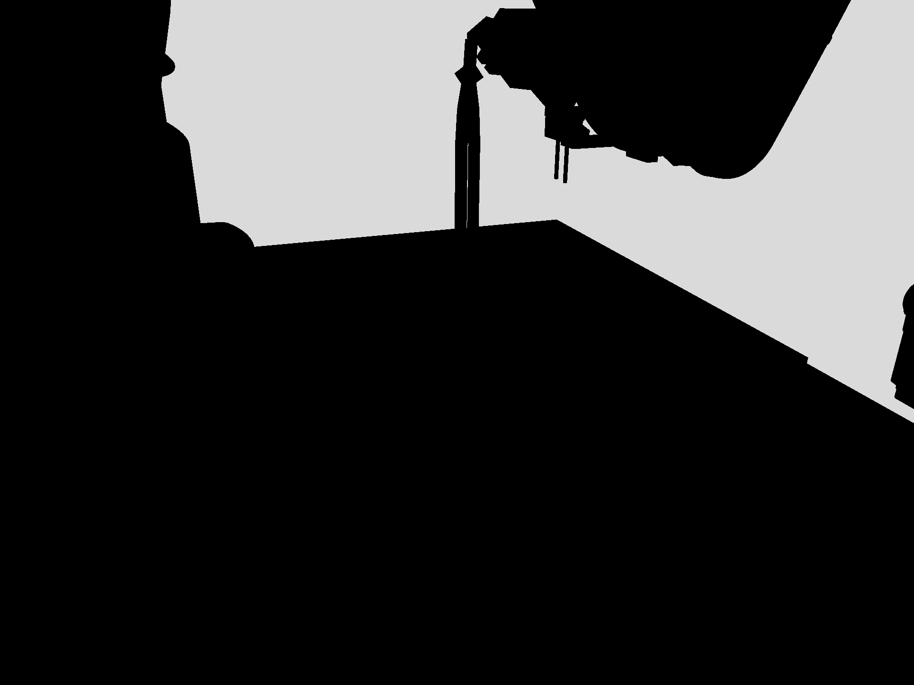
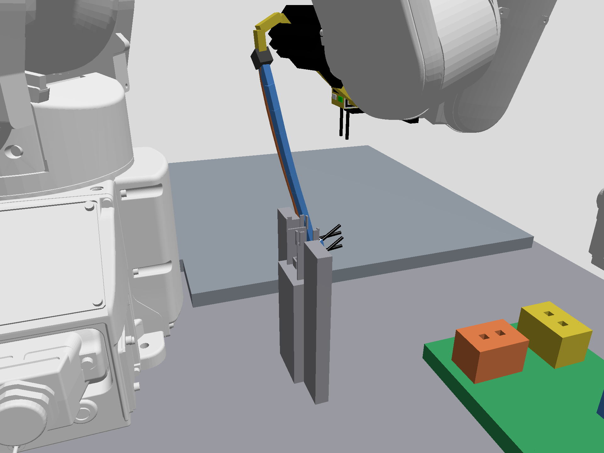

# 治具カメラの初回画像と後続画像

実行中の `stepped_full_p3_hd64_20261016` の治具搬送中に、ネイティブRGB画像だけを別の購読プロセスで取得した。カメラ、照明、物理world、ロボット指令は変更していない。購読は各プローブ後に終了した。

- 142.8秒の `nest_camera_probe1.png`：背景以外がほぼ黒く、マーカーを読む画像として不適切だった。
- 148.8秒の `nest_camera_probe2.png`：正常な色が出ており、治具と基板が見える。比較時のinspection画像も取得し、両方の数値を `camera_comparison_probe2.json` に残した。

後続の治具画像にはチャンネル差20を超える画素が227,526あった。この数は色が出ていることの診断であり、マーカーの認識精度や正常な接続を示さない。P3は搬送中で腕に一部遮られており、治具着座後や持ち替え直前の認識はこれから検証する。

恒常的なカメラ故障や照明設定の不備とは断定しない。初期描画・購読開始の過渡状態などは候補で、原因は未特定。悪い初回フレームも残し、後段の認識では新規の複数フレームと既存の安定条件を要求する。画像を成功した把持・着座・接続の証拠へ読み替えない。
