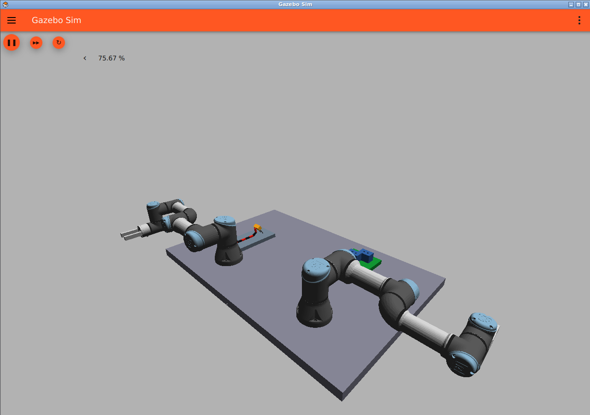

# 双腕で搬送ハーネスを基板へ接続する工程

## 今回の要件

ハーネス端のコネクタを把持し、図面に指定された基板側の受けコネクタへ接続する。ハーネスは搬送装置で作業域へ入り、停止後にカメラで端末を認識する。ワイヤーの柔らかい挙動を物理シミュレーションで再現する。

左腕はコネクタのハウジングを把持して挿入する。右腕はワイヤーの途中を支え、引っ張り過ぎや接続部への横荷重を抑える。二つの直交軸装置ではなく、関節を持つ独立した2本のロボットアームを使う。

## 採用する双腕モデル

[三菱電機の参考ページ](https://www.mitsubishielectric.co.jp/fa/media/html/module_popup.html?movieNO1=0000000061&kisyuNO=robot)に掲載されたBYNAS双腕型システムはRV-4FLを2台組み合わせる構成。このデモでも独立した6軸アームを2台使う。

モデルはUniversal Robotsの**UR3e×2**。公式の[ROS 2 Description](https://github.com/UniversalRobots/Universal_Robots_ROS2_Description/tree/jazzy)をUbuntuの`ros-jazzy-ur-description`から読み込み、xacro→URDF→SDFへ変換する。公式メッシュ、関節フレーム、限界角、慣性を使用し、左右に別の名前とTopicを付ける。GazeboのJointPositionControllerで動かすため、現時点では公式ドライバやMoveItの経路計画を使っていない。

先端の2本の指は自作の固定形状で、開閉・把持制御はまだない。腕の配置は暫定であり、全工程の到達性・干渉はIKと経路計画の段階で検証する。モデルのメッシュはリポジトリに複製せずインストール先を参照する。生成SDFの由来とライセンスは`THIRD_PARTY_NOTICES.md`に記載する。

## 工程

1. 図面画像からハーネス番号、端末、基板の接続先、向き、座標を読む。
2. 搬送台にハーネスを載せ、作業位置まで送り停止する。
3. 上方カメラ画像から端末とワイヤーを認識し、校正値で画像座標をロボット座標へ変換する。
4. 左腕がコネクタを把持し、右腕がケーブルを支える。
5. ケーブルの垂れ・揺れと周辺物との接触を保ちながら基板へ搬送する。
6. コネクタを合わせて挿入し、解放・退避して着座を検査する。

## 柔軟ケーブルの近似

12本の25 mm長の剛体セグメントを2自由度のuniversal関節でつなぐ。各関節に曲げばねと減衰を設定し、重力とセグメントの衝突を有効にする。固定された見た目だけのケーブルを置き換える。

初期パラメータ：長さ300 mm、断面8 mm角、各セグメント4 g、曲げばね0.003 N m/rad、減衰0.002 N m s/rad。端末の形状は従来の拡大2ピンプラグを暫定的に使う。

これは離散的な柔軟体の近似で、実ハーネスの曲げ剛性・摩擦・ねじり・材料特性を計測して合わせたものではない。まず垂れ、持ち上げ時の変形、揺れ、支持点を変えたときの挙動を検証する。連続体・有限要素モデルが必要なら、その結果を見てGenesisなどの別環境を検討する。

仕様参考：[SDFormatの関節・ばね・減衰](https://sdformat.org/spec/1.9/joint/)。

## 試作と実装状況

Docker内で公式モデルの依存関係を使い、次を生成する。

```bash
docker compose build dev
docker compose run --rm dev python3 scripts/build_factory.py
```

- `sim/worlds/factory_prototype.sdf`：双腕6軸ずつ、関節ケーブル、可動搬送台、上方カメラ、接続先J1/J2の配置。
- `sim/worlds/arms_test.sdf`：左右のUR3eを独立制御する単独検証用world。
- `sim/worlds/cable_test.sdf`：端末を固定してケーブルを自由に垂らす単独検証用world。

```bash
docker compose run --rm dev python3 scripts/check_arms.py
docker compose run --rm dev python3 scripts/check_cable.py
```

試作worldの腕関節には位置制御用Topicを用意した。画像は`/factory/image`、搬送台は`/conveyor/cmd`、腕は`/left_arm/joint_0/cmd`から`joint_5/cmd`、右腕も同様。

カメラ校正、端末の画像認識、腕のIK・衝突回避、左右の把持・支持、搬送停止から接続までの統合制御は開発中。配置worldの生成と、双腕が実際に接続工程を完了することは区別する。旧デモは固定ケーブル・直交ロボットであり、今回の要件を満たす完成品とは扱わない。

GUIで表示する場合：

```bash
docker compose --profile gui up -d --build gui
docker compose exec gui bash -c 'source /opt/ros/jazzy/setup.bash; gz sim -r sim/worlds/factory_prototype.sdf --gui-config sim/gui.config'
```

[noVNC](http://localhost:6080/vnc.html?autoconnect=true&resize=scale)で確認できる。起動時は相互衝突を避けるため両腕を外向きに配置している。作業姿勢への移動は今後の経路計画で実装する。



## 双腕モデル検証（2026-10-10）

`ur_description` 3.5.1からUR3eを2台生成し、Gazeboで重力を有効にしてROS 2経由で指示した。左の基部関節に+0.30 rad、右に−0.25 rad、残り10関節に0 radを指示し、10秒後のフィードバックを確認。全12関節の最大誤差は約0.0067 radで、許容0.025 rad以内だった。[検証結果](evaluation/arms_validation.json)。

初期配置では腕同士が衝突したため、起動姿勢が外向きになるようベースの向きを修正した。また、重力による定常誤差と手首の振動が出たため、腕と手首でゲインを分け、積分項と公式のトルク上限を設定した。動作検証はこの小さな基部回転と他関節の保持のみであり、全可動域、協調軌道、挿入精度、接触時の制御を保証するものではない。

## 単独ケーブル検証（2026-10-10）

Gazeboで端末を固定し、12セグメントを重力下で15秒実行した。リンク13個の姿勢を283回受信し、端末から最下点まで約278 mm垂れることを確認。[検証結果](evaluation/cable_validation.json)を保存した。姿勢はモデル内の座標で、リンク順序には依存しない。

この確認は重力下の垂れのみ。実材料に合った弾性、動的な把持・揺れ、接触摩擦、張力の妥当性は未検証。双腕版を完成済みとは扱わない。
