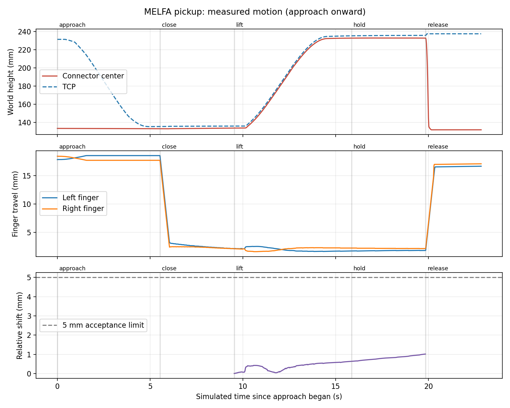

# 画像からのMELFA端末把持

ローカルAIの図面読解、新しいRGB-D画像からの把持姿勢推定、MELFA RV-4FRLによる1端末の把持・持ち上げ・解放を一括実行した。3端末がつながった柔軟ハーネスを使い、D101／配置seed2のP1を左腕で扱った。支持する右腕、他の端末の接続、基板への挿入はまだ動作させていない。

## 一括実行

```bash
python3 scripts/run_perception_demo.py \
  --design-seed 101 --placement-seed 2 \
  --output outputs/melfa_pick_pipeline --evaluate --pick-connector P1
```

`--pick-connector`は全3端末の6D観測を必須にする。シーンを生成して起動し、MacのローカルQwen3-VLで今回の図面を読み、基板と照合する。続いて全端末のIK計画を作り、動作直前にRGB-D画像を再取得して指定端末の把持候補を計算する。以前の画像を再生して動作する処理ではない。

画像取得後は描画負荷を減らすためRGB-Dを5 Hzから0.01 Hzへ一時的に下げ、終了時に元へ戻す。[Gazebo Sensorsの更新頻度サービス](https://github.com/gazebosim/gz-sensors/blob/gz-sensors8/src/Sensor.cc)を使う。`--keep-camera`を追加すると通常の頻度を保つ。この段階の制御は取得済みの静止画像を使い、動作中の画像追従は行わない。

すでに同じシーンがGUIコンテナで動いている場合は、次のCLIで再観測してから試験できる。

```bash
docker compose exec -T gui bash -c 'source /opt/ros/jazzy/setup.bash && \
  python3 scripts/pick_connector.py \
    --world outputs/melfa_pick_pipeline/case/world.sdf \
    --board outputs/melfa_pick_pipeline/case/board.json \
    --plan outputs/melfa_pick_pipeline/connection_plan.json \
    --plug P1 --output outputs/melfa_pick_retry'
```

端末が手先で隠れている場合は再観測できないため、一括実行でシーンを再起動する。現在は1回の把持試験が対象で、連続した全端末処理のCLIではない。

## 制御と判定

画像由来の工具姿勢へ届く腕を選び、開指・待機点・直線接近・閉指・100 mm持ち上げ・4秒保持・解放を実行する。下降と上昇は10 mm以下の目標点ごとにIKを計算し、関節角を補間する。途中のIK失敗や0.25 radを超える関節角の飛びは、経路を送る前に拒否する。衝突回避を備えた経路計画ではない。

軌道と保持時間はGazeboの時刻に合わせる。シミュレーションが実時間より遅い環境でも、4秒保持はシミュレーション上の4秒で判定する。停止や収束失敗には実時間の上限も設ける。

関節状態と独立したGazebo手先姿勢を照合し、工具位置2 mm・姿勢0.025 rad・関節誤差0.01 rad以内が5回続いた場合に次へ進む。FKとGazebo姿勢の差も1 mm以内を必要とする。動作前には供給したモデルと実際の腕の整合性を確認し、待機点へ移動する間に端末が4 mm以上動いたら、下降を開始しない。

保持は以下の全条件で判定する。

- 端末と工具がともに70 mm以上上昇。
- 保持中の相対移動と、閉指完了時から保持中の相対ずれが5 mm以内。
- 指間隔が既知の端末幅20 mmに対して±1 mm以内で、指位置も関節範囲内。
- 10件以上の新しい保持観測がある。
- 解放後に端末が30 mm以上下降。

指位置は左右で偏るため、指間隔は`16 mm + 左指移動量 + 右指移動量`で計算する。空の閉位置16 mmや開いた52 mmは保持条件に入らない。接触力そのものの計測ではなく、端末の追従、指の開き、解放を合わせた判定である。

制御は[GazeboのJointPositionController](https://github.com/gazebosim/gz-sim/blob/gz-sim8/src/systems/joint_position_controller/JointPositionController.cc)のPIDを使う。端末とグリッパーを結ぶ固定ジョイントや、端末位置の書き換えは追加していない。認識・目標生成へGazeboの端末正解位置を渡さず、正解姿勢は到達・保持評価と停止条件に使う。

## 検証記録（2026-10-11）

| 指標 | 結果 |
| --- | --- |
| 使用ケース | D101／配置seed2／P1／左腕 |
| 端末の最小上昇量 | 99.07 mm |
| 閉指完了時から保持中の最大相対ずれ | 1.02 mm |
| 保持中の相対移動 | 0.52 mm |
| 保持中の指間隔 | 19.94〜20.02 mm |
| 保持時間 | シミュレーション上の4秒 |
| 解放後の下降 | 100.97 mm |

[成功記録](evaluation/melfa_pick_seed2/validation.json)、[今回のローカルAI読解](evaluation/melfa_pick_seed2/connection_plan.json)、[AI監査記録](evaluation/melfa_pick_seed2/connection_plan.audit.json)、[画像からの把持候補](evaluation/melfa_pick_seed2/grasp_plan.json)を保存した。RGB・圧縮深度・内部／外部パラメータも同じフォルダにある。`depth.npz`の`depth`配列がm単位の深度画像。



グラフとCSVは接近以降を表示する。各実行フォルダの`trajectory.json`はシミュレーション時間で最大約50 Hz、保存したCSVは10 Hz以下へ間引いている。保持判定は保存前の新しい観測を使う。端末と工具の相対ずれは閉指完了時を基準にする。

## 試行からの修正

1. 最初は待機点で約9.15 mmの誤差が残ったため、把持前に停止。[失敗記録](evaluation/melfa_pick_seed2/hover_failure.json)を保存。MELFAの関節制御を調整した。
2. 続く試験では実際に持ち上がったが、旧判定の「各指の移動量0.8 mm以上」を片側が満たさなかった。[旧判定の記録](evaluation/melfa_pick_seed2/legacy_pinch_failure.json)は変更せず保存。20 mmの端末を偏ってつかめる条件として、指間隔と関節範囲の判定へ改めた。
3. 閉指時間を短くした試験では、閉指から保持中の相対ずれが約10.30 mmとなり、失敗を検出。[滑りの記録](evaluation/melfa_pick_seed2/slip_failure.json)。指の比例ゲインを200から1000へ変更し、指令の上限12は維持した。
4. 修正後の一括実行は上記の条件をすべて通過。[制御設定](evaluation/melfa_pick_seed2/control_profile.json)とworldのハッシュを保存。設定はシミュレータ用で、実機の制御ゲインではない。

48件の単体テストを通過。偏った把持、空閉じ・開いた指・関節範囲外の拒否、滑り、JSON保存、IK連続性を含む。以前の摩擦あり／ゼロの物理記録にも現行の判定を適用し、[同じ正負の結果](evaluation/melfa_pick_seed2/criterion_regression.json)になることを確認した。[両腕の独立制御](evaluation/melfa_pick_seed2/arms_validation.json)と[両グリッパーの空の開閉](evaluation/melfa_pick_seed2/gripper_validation.json)も調整後に通過した。

この結果は1ケース・1端末の試作検証である。実測カメラ校正、実材料の摩擦・張力の校正、一般形状の端末認識、自己衝突／双腕干渉回避、搬送、支持、全端末の挿入は未完了。次は持ち上げたハーネスをもう片腕で支え、接続先への移動へつなげる。
