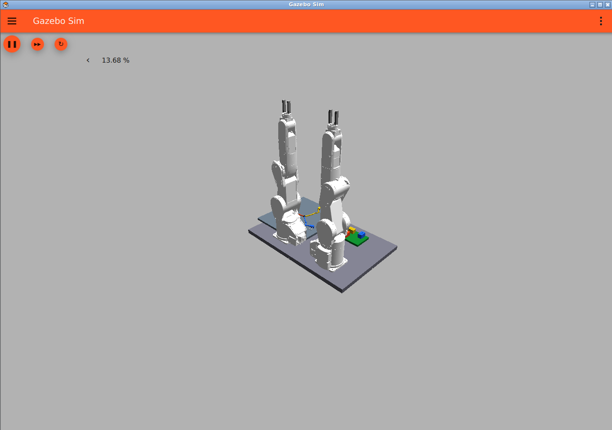

# Mitsubishi Electric MELFAのモデルを使う

## 適用方法

[公式melfa_ros2_driver](https://github.com/MitsubishiElectric/melfa_ros2_driver)の`melfa_description`に含まれるRV-4FRLを2台使う選択肢を追加した。参考動画のRV-4FLと同一機種ではないが、独立した産業用6軸アーム2台という構成に合わせられる。公式モデルの形状・関節・可動限界を読み込み、左右に別のprefixと制御Topicを付ける。

公式の[使用手順](https://github.com/MitsubishiElectric/melfa_ros2_driver/blob/humble/doc/melfa_ros2_driver.md)はROS 2 Humble向けで、RVizのfake hardware、実機/RT ToolBox3、Gazebo Fortressでの使用を説明している。現在のプロジェクトはJazzy/Harmonicなので、そのlaunchをそのまま使う対応ではない。

今回の試作ではモデル記述パッケージのみをビルドし、独自xacro wrapperでハードウェア設定を含めずモデルを生成する。URDFをSDFへ変換し、既存のGazebo位置制御とROS 2 bridgeを使う。実機通信の`melfa_driver`、GPIO、公式MoveIt設定の起動・互換性は検証していない。実機やRT ToolBox3への接続は行わない。

## 再現手順

```bash
bash scripts/setup_melfa.sh
docker compose run --rm dev bash -c 'source outputs/melfa_install/setup.bash; python3 scripts/build_factory.py --robot melfa_rv4frl --output outputs/melfa_worlds'
docker compose run --rm dev bash -c 'source outputs/melfa_install/setup.bash; python3 scripts/check_arms.py --robot melfa_rv4frl --world outputs/melfa_worlds/arms_test.sdf'
docker compose run --rm dev python3 scripts/build_case.py \
  --factory-world outputs/melfa_worlds/factory_prototype.sdf \
  --design-seed 101 --placement-seed 2 --output outputs/melfa_case
```

取得元をcommit `10098bed6bcca4e4bef46e36389a839065f8cb22`（humble、melfa_description 1.1.1）に固定する。モデルソースは`.cache`、ビルド・インストールは`outputs`で、Gitへメッシュを複製しない。生成worldはインストール先の絶対パスを参照するため、別の環境では上の手順で生成し直す。Apache 2.0の表示は`THIRD_PARTY_NOTICES.md`と`licenses/melfa_APACHE-2.0.txt`に保存した。

GUI：

```bash
docker compose --profile gui up -d gui
docker compose exec gui bash -c 'source /opt/ros/jazzy/setup.bash; source outputs/melfa_install/setup.bash; gz sim -r outputs/melfa_case/world.sdf --gui-config sim/melfa_gui.config'
```

すでに別のGazeboを表示している場合は、そのプロセスを終了してから起動する。UR3eの既存手順も残し、`--robot`の指定で選択する。

## 検証結果と限界

Jazzyの既存Docker環境で`melfa_description`のビルドに成功し、RV-4FRL×2のworldと複数端末worldのSDF構造検証を通過。ROS 2から左の基部関節へ+0.30 rad、右へ−0.25 rad、残り10関節へ0 radを指示した。10秒後の全12関節の最大誤差は約0.0027 radで、許容0.025 rad以内だった。[実測記録](evaluation/melfa_arms_validation.json)。既存を含めた12件の単体検証も通過した。

これは当時の基部の小さな回転と直立姿勢保持の検証。その後の端末・接続先上方へのIKと隔離シーンの制御確認は[到達性確認](reachability.md)を参照。双腕の経路計画、把持・挿入の成功は未検証。

公式の`rv4frl_macro.xacro`には質量について`These mass are INCORRECT`と記載があり、慣性も単純な円柱から計算されている。シミュレーションの形状・関節モデルとして使用するが、実機相当の慣性・トルク・接触力・ケーブル張力を再現したとは扱わない。力に関する検証には物性の校正が必要。先端の指も現時点では固定形状の試作である。


