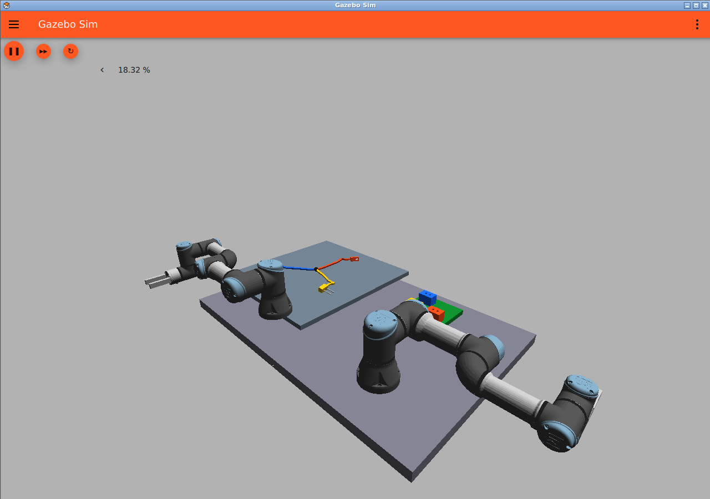

# 一品一様の基板へ、1本のハーネスの全コネクタを接続する

## 要件

1本のハーネスは複数の端末コネクタを持ち、そのすべてを今回の図面が指定する基板側コネクタへ接続する。ハーネスの置き方は毎回変わる。基板の設計と図面も案件ごとに変わり、両者は必ず整合する。

まず3端末（P1/P2/P3）の分岐ハーネスで実装する。共通の束部分から3本の枝を伸ばし、各枝に9本の25 mm長のセグメントと端末を付けた。31リンク、27個の曲げ関節、3個の端末固定関節で、物理的に一つの木構造としてつながる。端末を動かすと他の枝にも力が伝わる。端末の識別は暫定的に赤・青・黄と白い向きマーカーを使う。

完了条件は、指定された全端末の位置・向き・挿入深さが許容範囲に入り、解放後も全端末の着座が維持されること。1端末だけの接続では完了しない。ラッチや導通判定は今後の拡張として扱う。

## 生成と実行

```bash
docker compose run --rm dev python3 scripts/build_case.py \
  --design-seed 100 --placement-seed 1 --output outputs/case_a
python3 scripts/read_connection_plan.py outputs/case_a/drawing.png \
  --board outputs/case_a/board.json --output outputs/case_a/ai_plan.json
docker compose run --rm dev python3 scripts/check_cable.py \
  --case-world outputs/case_a/world.sdf
```

seedを省略すると毎回新しい値を生成する。同じ設計で置き方だけ変える場合はdesign-seedを固定しplacement-seedを変更する。同じ二つのseedで再現できる。

生成物は`case.json`（設計＋初期配置）、`board.json`（設計）、`drawing.png`、`world.sdf`、`manifest.json`（各ファイルのSHA-256）。基板の穴・受けコネクタと図面の座標・向き・接続表は同じ設計データから生成する。設計seedによって基板寸法、受けコネクタの配置・0/90度の向き、端末との対応を変える。

配置seedではハーネスの平面内の位置、全体回転、各枝の角度・曲がりを変える。枝の長さと接続構造は変えない。初期配置は搬送台上の限定された範囲で、重なりの少ない形を生成する。絡まり、上下に積み重なった端末、裏返し、任意のハーネス形状に対応したものではない。

## AIと制御の境界

ローカルQwen3-VLに渡すのは図面画像と共通の読解指示だけ。設計JSON、初期配置、正解接続表をモデルには渡さない。出力にはdrawing_id、board_id、harness_id、全端末のconnections配列を要求する。推論後に今回の設計と照合し、端末の欠落・重複、誤接続、座標・向き・基板番号の不一致を拒否する。検証器は誤答を正解に補正しない。

`case.json`の初期配置はシミュレーション生成専用。これを把持位置として制御へ渡さず、端末の位置・向きはカメラから推定する方針。現時点では端末認識と把持制御の統合は未実装。

## 接続工程で必要な追加実装

- 全端末の認識と、図面の端末番号との対応付け。
- ケーブル長と接続済み端末の拘束を考慮した接続順序。
- 片腕で端末を持ち、もう片腕で束を支える協調軌道と干渉回避。
- 接続済み端末を引き抜かない支持点の変更、接触・張力の検証。
- 全端末の着座を継続して確認する完了判定。

モデル生成、図面読解、柔軟ハーネスの物理検証は、双腕による全端末接続の成功とは区別して報告する。

## 検証記録（2026-10-10）

設計100/配置1と設計101/配置2を生成し、SDFの構造検証を通過した。設計101ではP1→J2、P2→J1、P3→J3で、J1/J2の向きは90度。基板寸法も190×190 mmから220×170 mmへ変化する。生成例は`examples/multi_connector/a`と`b`に保存した。

Gazeboで腕とカメラを除いたハーネス物理検証を各15秒実行し、両ケースで31リンクを受信した。最終時点のリンクの高さの幅は約116 mmと40 mm。[ケースBの実測](evaluation/multi_harness_validation.json)。これは変形を確認する簡単な動作検証で、安定性・張力・材料特性の検証や、接続成功の判定ではない。

単体検証は既存8件＋新規4件を通過。新規検証では100設計の全接続表の受け入れ、欠落・重複・誤対応・誤座標・誤向き・別基板の拒否、設計と配置の独立性、全端末が同じ物理木構造につながることを確認した。

ローカルQwen3-VL 2Bは、表記を明確にした図面A/Bで各3件、計6件の接続先・座標・向きを正しく抽出した。[Aの出力](evaluation/multi_ai_a.json)、[Bの出力](evaluation/multi_ai_b.json)と推論auditを保存した。最初のAではハーネス・端末・接続先の番号を混同し検証器が拒否したため、図面をHARNESS/PLUG/SOCKETの明示表記に変更し、共通プロンプトも整理した。最初の誤答も`evaluation/multi_ai_initial_failure.audit.json`に残した。これは2図面の動作確認であり、未知の任意図面に対する認識性能を示すものではない。


