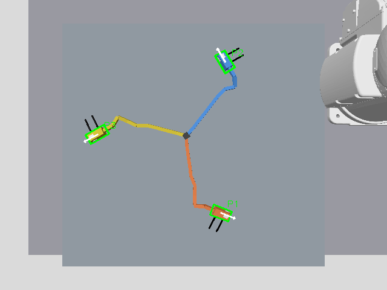

# MELFA双腕のRGB-D端末認識

搬送台を見下ろすRGB-DカメラをGazeboに追加し、ROS 2でカラー画像、深度、CameraInfoを受信する。ランダムに置かれた試作ハーネスのP1/P2/P3について、見えているハウジング上面の3次元位置と平面内の向きを求める。

## 実行

```bash
python3 scripts/run_perception_demo.py --design-seed 101 --placement-seed 2
```

seedを省略すると毎回変える。現在のプロジェクトのGazebo画面を再起動して新しいシーンを開き、検出結果を`outputs/perception_demo/observations/detections.json`に保存する。`camera.png`、注釈付き`detections.png`、`depth.npy`も保存する。MELFAモデルのインストールがなければ固定リビジョンの導入スクリプトを実行する。DockerのGUIイメージは事前に`docker compose --profile gui build gui`で用意する。

精度評価も行う場合：

```bash
python3 scripts/run_perception_demo.py --design-seed 100 --placement-seed 1 --evaluate
```

評価専用の別プロセスが、Gazeboの名前付き正解姿勢を購読し、カメラ時刻と0.1秒以内で照合する。検出器へ正解姿勢、配置seed、case.json、端末の初期座標を渡すことはない。通常モードではこの評価用購読を起動しない。

## 認識と座標変換

- P1=赤、P2=青、P3=黄の既知の試作部品を、色と形状で識別する。細いワイヤーを画像の形態処理で除去し、幅のあるハウジングを探す。
- 正のX側に白いマーカーを付け、長軸の180度の曖昧さを解消する。端末が横倒しになることが実画像で確認されたため、上下・両側面にマーカーを追加した。
- 同時刻のRGB/深度画像を使い、画像の寸法・frame IDも確認する。焦点距離・主点はCameraInfoから読み、深度で逆投影する。
- 外部校正は`configs/infeed_camera.json`の既知のシミュレータ設置姿勢を使う。カメラの取り付け誤差や歪みを実測した校正ではない。
- 全3端末の位置がフレーム間で3 mm未満、向きが0.08 rad未満の変化に収まる状態を3フレーム確認してから結果を出す。
- マーカー欠落、深度欠落、同色の複数候補、全端末の不足は受け入れない。新しい取得が失敗した場合に前回の検出JSONを残さない。

ROS 2の入力は`/factory/rgbd/image`、`/factory/rgbd/depth_image`、`/factory/rgbd/camera_info`。一回取得のノードは全端末の結果をJSONとして`/factory/connector_detections`（std_msgs/String）へ一度publishして終了する。受信側は取得前から購読する。保存JSONを次の開発段階の入力として確認できるが、制御へ使う際には時刻・鮮度を再検証する必要がある。

カメラは[GazeboのRGB-Dセンサ](https://gazebosim.org/api/sensors/8/classgz_1_1sensors_1_1RgbdCameraSensor.html)をOgre2で描画し、[公式ROS-Gazebo bridgeのRGB-D構成](https://github.com/gazebosim/ros_gz/blob/ros2/ros_gz_sim_demos/config/rgbd_camera_bridge.yaml)に沿って橋渡しする。搬送台にアーム基部が重なっていた配置も修正し、基部を搬送台の外へ移した。腕の到達性・干渉回避は今後のIKと経路計画で検証する。

## 現時点の制約

画像認識は既知の色・マーカーを使う画像処理で、学習済み物体検出モデルではない。AIは引き続きローカルQwen3-VLによる図面読解に使用する。未知の部品、同色の端末、隠れた端末、絡まったハーネスへの対応は未検証。

得られる座標は可視表面で、コネクタ中心とは異なる。向きは平面yawのみで、横倒しのroll/pitchを含む完全な6D姿勢ではない。把持・持ち直し・挿入を完成させるには、6D姿勢と把持点、IK、支持動作、接続順序、接触を確認する必要がある。認識成功を接続成功とは扱わない。

次の検証では、図面の全接続表と検出端末を対応させ、把持姿勢と左右の到達性を評価する。

## 実画像での検証（2026-10-10）

MELFA双腕を含むGazeboシーンで、配置seed1/2の双方で3端末を検出した。検出位置は可視表面であり、表面位置のXYを正解のハウジング中心XYと比較している。姿勢は正のX軸の平面yawを比較した。合格閾値はXY 8 mm・yaw 0.15 rad。

| 配置seed | 検出 | 最大XY誤差 | 最大yaw誤差 | 正解との時刻差 |
| --- | --- | --- | --- | --- |
| 1 | 3/3 | 5.26 mm | 1.61 deg | 0.000 s |
| 2 | 3/3 | 4.17 mm | 1.51 deg | 0.002 s |

[seed1の記録](evaluation/perception_seed1/validation.json)、[seed2の記録](evaluation/perception_seed2/validation.json)に画像、検出JSON、評価専用の正解姿勢とシーン設定を保存した。最初は上面マーカーが見えず全端末認識に失敗し、複数面マーカーへ変更した。評価プロセス終了時にnative購読の終了処理が不十分だったため、購読解除を明示し、一括実行が正常終了することも確認した。

既存12件に加え、画像認識5件（全端末の識別・座標変換、マーカー欠落、深度欠落/同色複数候補、RGB/深度寸法不一致、校正値不正）を通過した。2配置の確認であり、未知の置き方すべてへの成功率や挿入精度は示していない。


