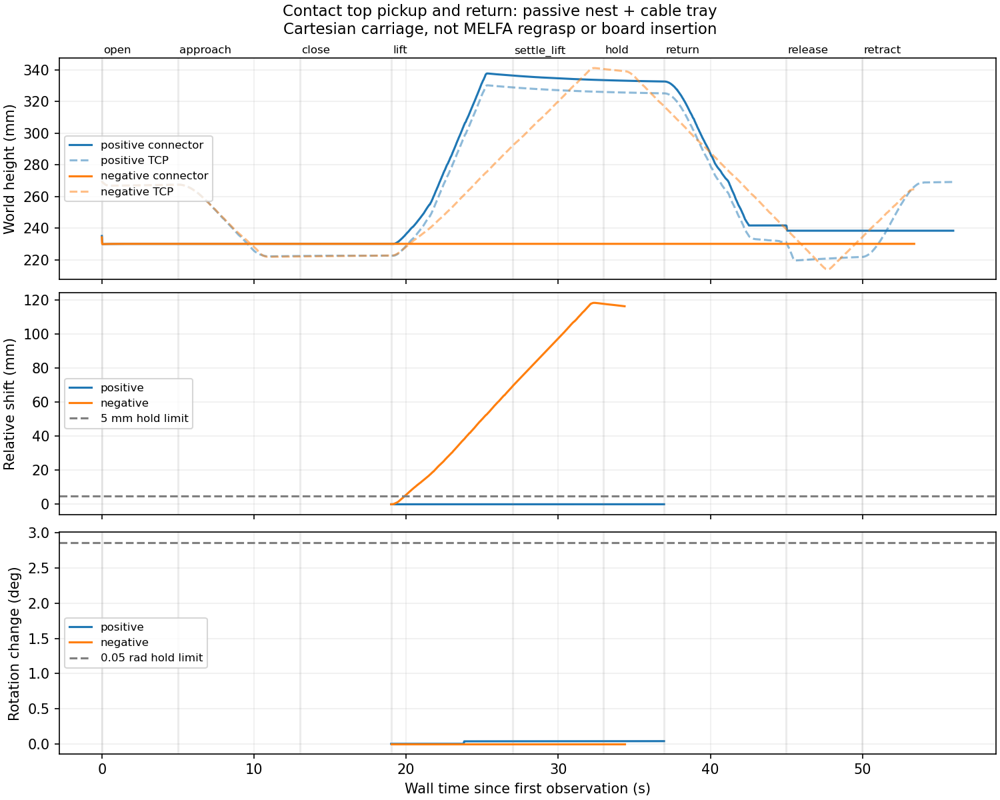
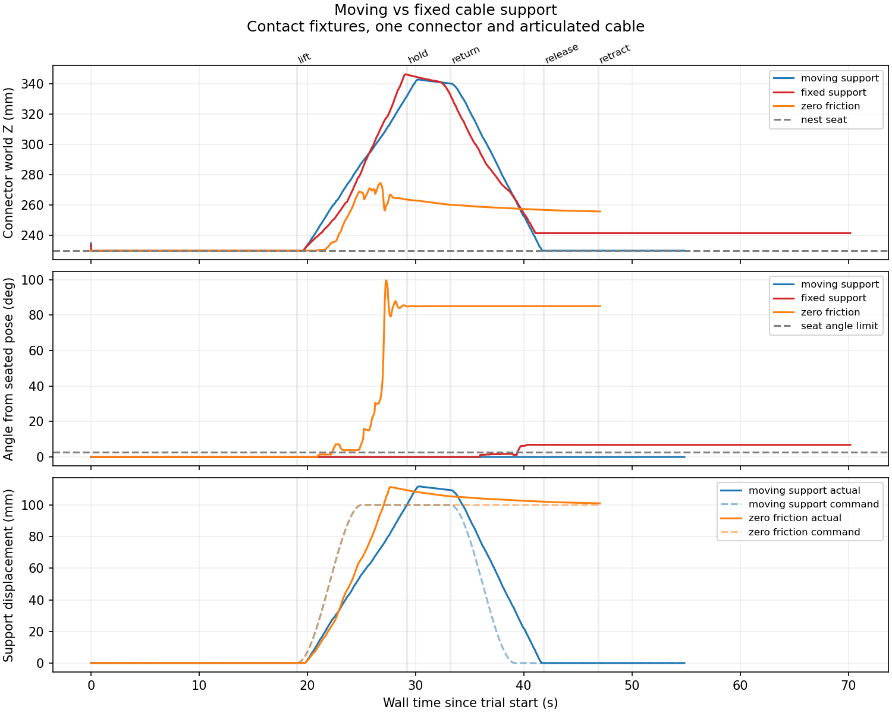

# 上面把持への持ち替え：治具・把持試験・下降経路

2026-10-11。横から把持した姿勢では基板への下降が包絡箱検査に通らなかったため、端子を一度治具へ置き、上面から把持し直す工程の開発を進めました。双腕による持ち替えの一連動作はまだ統合していません。

2026-10-11に確認したのは、受動治具による端子保持、固定支持台を使った上面把持・持ち上げ・姿勢保持、上面把持後を仮定したMELFA双腕の下降経路です。この段階では治具へ戻す動作は未成立でした。2026-10-12に、独立して昇降するケーブル支持台と把持時の実測関節位置への戻しを組み合わせ、直動試験台で開放・退避後の着座まで通過しました。MELFA双腕での持ち替えは未統合です。

## 持ち替え治具

`regrasp_fixture.py`で、ハウジング両端の支持、端部の横ずれガイド、低いピン案内溝、ケーブル出口と根元のケーブル受けを生成します。中央の長軸方向±10 mmを把持用に空けています。ピン直径は4 mm、案内溝は8 mmです。ハウジングの横方向のすき間は1 mmです。

工場シーンでは治具中心を世界座標 `(0.08, -0.04)` m、受け面を高さ0.22 mに置きます。搬送パレットと基板の間の空間を使います。治具には固定ジョイントや端子の取り付け機構を使っていません。

一端子・12リンクの柔軟ケーブルを重力下で放し、3〜6秒の姿勢を観測しました。治具ありでは横ずれが最大約1.00 mm、着座高さの誤差は0.001 mm未満でした。治具なしでは約155 mm落下しました。ケーブルの高さ方向の広がりは治具ありで約185 mmあり、ケーブル全体を固定した試験ではありません。

```bash
docker compose exec -T gui bash -lc \
  'source /opt/ros/jazzy/setup.bash && python3 scripts/check_regrasp_nest.py --output outputs/regrasp_nest_test'
```

[治具あり・なしの検査結果](evaluation/regrasp_seed2/passive_validation.json)と、それぞれのSDF・観測履歴を保存しました。初期条件は治具の上に置いた端子であり、ロボットが治具へ置く工程を実行した試験ではありません。

## 上面把持の接触試験

既存の直動試験台を拡張し、ピン付き端子を治具からつかみ、100 mm持ち上げる指令で保持、治具への戻し、開放、指の退避を行います。グリッパーの指は接触面を二つに分け、長軸方向の別々の場所で接触させる試作版です。上面把持のTCPは端子中心から6 mm下で、ハウジング高さ20 mmのうち約16 mmを接触に使います。

保持判定には持ち上げ高さ、TCPとの位置関係、指の実際の隙間に加え、閉じた時からの端子の回転量0.05 rad未満を要求します。観測に回転行列がある場合、欠落・非有限・非剛体の行列も拒否します。回転を観測していない過去のデータでは `rotation_validated=false` と明記します。

ケーブル尾部を受け台で支える条件では、上面把持と姿勢保持が通過しました。受け台は固定された受動的な台であり、支持する右腕の代わりの限定的な機械試験です。支持なしでは、約100 mm持ち上がっても端子が数十度回転し、姿勢保持の判定を通りませんでした。

| 固定支持台の試験（2026-10-11） | 実測値・判定 |
|---|---:|
| 保持中の最小持ち上げ量 | 102.55 mm |
| 閉じた時からの位置関係の最大変化 | 0.0179 mm |
| 閉じた時からの最大回転 | 0.038° |
| 保持 | 通過 |
| 戻した後の着座高さの誤差 | 8.30 mm |
| 治具への戻し | 未成立 |

戻しの際に端子が傾いたため、持ち上げ成功だけを全工程の成功として扱っていません。

摩擦ゼロではTCPだけが上昇し、端子は治具に残りました。物体の取り付け、位置の書き換え、摩擦を無視した保持を使っていません。試験台の関節位置が収束したことを確認してから保持を判定し、過渡状態を保持窓に混ぜないようにしました。

```bash
# 支持ありの把持・戻し試験。現在、戻しが未成立の場合は終了コード1になります。
docker compose exec -T gui bash -lc \
  'source /opt/ros/jazzy/setup.bash && python3 scripts/grasp_benchmark.py --regrasp-nest --support-tail --output outputs/regrasp_top_test'

# 摩擦ゼロの負の比較。保持できないことを確認する試験です。
docker compose exec -T gui bash -lc \
  'source /opt/ros/jazzy/setup.bash && python3 scripts/grasp_benchmark.py --regrasp-nest --support-tail --friction 0 --expect-slip --output outputs/regrasp_top_zero'
```

保持と戻しの判定はレポートの `hold.success` と `reseat_success` に分かれます。`success` は保持・戻しを含む全試験の判定なので、保持だけ通っても戻しが失敗すれば偽です。摩擦ゼロの比較は `expectation_met` が判定です。



[支持ありの結果](evaluation/regrasp_seed2/positive_validation.json)、[摩擦ゼロの結果](evaluation/regrasp_seed2/negative_validation.json)、10 Hzへ間引いたCSVを保存しています。支持なし、浅い案内溝、狭すぎる案内溝、ケーブル出口の干渉などの失敗は `failures/` に保存しました。

## 持ち替え後を仮定したMELFA下降経路

治具と分割接触パッドを含むMELFA RV-4FRL×2のシーンを生成しました。P1をJ2の上面から挿入する工具姿勢で、左右腕のIKを連続的に解き、両TCP間距離、左右腕の包絡箱、固定治具との干渉を評価しました。名目上の上面把持を開始条件とした下降経路が通過しています。

着座時はハウジング中心が受け側の縁から10 mm上、TCPはその6 mm下なので、指先と縁の名目上の距離は4 mmです。そのため固定治具との箱の余裕は各箱1 mmとし、双腕同士の余裕は各箱5 mmを維持しています。位置誤差や力・接触を含む実行の安全性を保証する値ではありません。

```bash
docker compose exec -T gui bash -lc \
  'source outputs/melfa_install/setup.bash && python3 scripts/build_factory.py --robot melfa_rv4frl --split-finger-contacts --output outputs/melfa_regrasp_worlds'

docker compose exec -T gui python3 scripts/build_case.py \
  --design-seed 101 --placement-seed 2 \
  --factory-world outputs/melfa_regrasp_worlds/factory_prototype.sdf \
  --regrasp-nest --output outputs/regrasp_factory_case

docker compose exec -T gui python3 scripts/regrasp_plan.py \
  --source docs/evaluation/melfa_dual_pick_seed2 \
  --transfer-report docs/evaluation/melfa_transfer_seed2/report.json \
  --target-world outputs/regrasp_factory_case/world.sdf \
  --target-models outputs/melfa_regrasp_worlds \
  --output outputs/top_regrasp_study.json
```

元の図面・AI接続計画・基板・モデルのハッシュを検証し、変更後のシーンでも基板と腕の順運動学が一致することを確認します。[下降の検査結果](evaluation/regrasp_seed2/top_descent.json)、治具付きworldとその生成manifest、治具設定を保存しています。元の把持状態から上面把持状態への関節角の飛びは実行しません。この計画には持ち替えが完了したという仮定があります。

一括シーン生成にも `--regrasp-nest` を追加しました。指定時は別の `outputs/melfa_regrasp_worlds` にモデルを生成し、従来のモデルを保持します。指定しない既存の双腕把持コマンドは従来のモデルを使います。このフラグは治具を加えるもので、持ち替えや挿入を自動実行するフラグではありません。

## 次の工程

### 両腕の接触診断・横方向カメラ・閉指判定（2026-10-13）

片側前面ストッパーの条件を、両腕の接触センサー付きworldで再試験しました。[両腕診断の記録](evaluation/melfa_nest_placement/bilateral/validation.json)では、閉指中に左右それぞれの接触パッドと端子ピンが接触しています。右は保持窓の開口が約20.0 mm、閉指時からの回転が約1.14°で保持を通過しましたが、左は開口が約29.0 mm、位置関係の変化が約6.53 mmで拒否されました。以前の試験では右が過大開口だったため、特定の腕だけに固定した問題ではありません。接触相手は記録できましたが、開口過大の主因や再現性はまだ確認できていません。

`--inspection-calibration configs/inspection_camera.json` で、作業台の横から見るRGB-Dカメラを追加できます。上方カメラは把持前の認識を続け、横方向カメラは `--verify-held-pose` の保持中照合に使います。カメラのGazebo姿勢と光学座標の一致を検査し、各観測に校正を保存します。横方向カメラは1 Hz、今回の位置は `(-0.65, 0.05, 0.55)` mで、`(-0.30, 0.05, 0.20)` mへ向けています。実測校正ではなく理想的なシミュレータ設定です。

[横方向カメラ付きの試験](evaluation/melfa_nest_placement/lateral_inspection/validation.json)は下降・閉指・持ち上げまで通りましたが、保持中の全3端子の6D観測は得られず照合が失敗しました。[保持中の画像](evaluation/melfa_nest_placement/lateral_inspection/held_pose_check/camera.png)では、腕に加えて指・ストッパーがマーカー面を隠しています。最後の部分検出も空であり、保持端子の姿勢をカメラで独立に確認できたとは扱いません。保持と照合待ちを合わせた回転量は左約5.02°、右約5.59°で、両側とも保持基準未達です。

閉指後の開口が20 mmとの差1 mm未満にならなければ、持ち上げ前に停止する判定を追加しました。空把持の16 mm開口と、ストッパーやピンで止まった広い開口を拒否します。非対称な左右指でも開口の合計で検査します。開口一致だけでハウジングの接触や安定把持を保証する判定ではありません。

[保存観測を使った閉指判定の再計算](evaluation/melfa_nest_placement/closure_replay.json)では、両腕診断の左29.83 mmと横方向カメラ試験の右27.46 mmを拒否しました。この追加前の物理試験では持ち上げまで進んでいますが、新しい判定ではその前に停止します。再計算は保存データへの検証であり、最終コードによる物理再試験は未実行です。

```bash
python3 scripts/run_perception_demo.py --design-seed 101 --placement-seed 2 \
  --evaluate --pick-connector P1 --support-plug P3 --regrasp-nest \
  --place-in-nest --gripper-p-gain 3000 --capture-gripper \
  --front-fence-side right --verify-held-pose \
  --inspection-calibration configs/inspection_camera.json \
  --headless --release-ai-memory --output outputs/melfa_lateral_inspection
```

次は、指が触れない端面のマーカーを検討し、把持直前にも姿勢を再観測できる構成を試します。その観測と接触記録を使って指とピンの干渉を減らし、両側で保持が通ってから治具搬送へ進みます。

### MELFAへの移植と回転保持の検査（2026-10-13）

`plan_nest_transfer.py` は、現在の横把持を維持したまま治具へ置く経路を計画します。治具の着座位置と向きは、worldの実際の支持面から取得します。開始状態を別のIK枝へ置き換えず、上昇・水平搬送・姿勢変更・治具上方・着座まで連続的に解きます。腕同士の箱は各5 mm、固定設備の箱は各1 mmの余裕で検査します。自己・ケーブル・物体との衝突や力を保証する検査ではありません。

両工具を同じ高さへ下ろす32候補では、治具への経路が通りませんでした。治具上方まで届く候補も、最後の下降で支持側が近すぎる姿勢となりIKが失敗しました。そこで、工具間距離を維持する球面上で支持点を高く残す経路を追加しました。支持側を相対的に100 mm高く残す候補が、元の持ち上げ終端から着座まで通過しています。関節補間を含む工具間距離の最大変化は約0.93 mmです。背面ストッパーを含むモデルでもオフライン検査が通過しました。

実行側は、保持が通った後の実測関節から改めて経路を計画します。意図した姿勢変更を滑りと混同しないよう、工具座標系でコネクタの位置・回転を比較し、5 mmまたは0.05 rad以上の変化があれば停止します。一次端子の開放後は、支持端子についてのみ保持を監視します。最後の開指はシミュレーションの後片付けであり、支持端子を保持して観測する着座窓とは分けています。

最初の物理試験は、治具搬送前に回転保持の判定を拒否しました。分割接触パッド、D101／配置seed2／P1・P3の条件です。

| 指の位置ゲイン | 左の最大回転 | 右の最大回転 | 判定 |
|---|---:|---:|---|
| 1000 | 約34.6° | 約22.0° | 保持失敗、治具へ進まない |
| 3000 | 約35.8° | 約20.4° | 保持失敗、治具へ進まない |
| 3000・背面ストッパー | 約20.3° | 約14.7° | 保持失敗、治具へ進まない |

両条件とも約100 mm持ち上がり、指の開口は約20 mmでしたが、主に指の閉じる軸の周りでコネクタが回転しました。ゲイン変更だけでは改善していません。以前の双腕評価は回転を観測しておらず、新しい分割パッドのこの結果と同一条件の回転精度を比較できません。

比較に続き、指に薄い背面ストッパーを追加しました。名目のハウジング背面との隙間は0.3 mmで、開いた指ではハウジングの外に退避します。ピン面を避け、幅を26 mmにして治具の端部支持と角部を避ける設計です。追加形状のある指の質量は11 gとしています。この形状は `--backstop-gripper` で有効にする試作版です。ゲインを変更する `--gripper-p-gain` ともども、従来のモデルを上書きせず別のモデルディレクトリを生成します。摩擦係数やケーブル物性、指の制御出力上限±12 Nは変更していません。

```bash
python3 scripts/run_perception_demo.py --design-seed 101 --placement-seed 2 \
  --evaluate --pick-connector P1 --support-plug P3 --regrasp-nest \
  --place-in-nest --gripper-p-gain 3000 --backstop-gripper \
  --output outputs/melfa_nest_backstop
```

`--place-in-nest` は治具へ配置し一次端子を開放・退避する試験工程です。上面からの再把持や基板への挿入はまだ行いません。図面はローカルQwen3-VLで読み、新しいRGB-D観測から把持候補を取得します。[ゲイン1000の失敗](evaluation/melfa_nest_placement/gain1000/validation.json)、[ゲイン3000の失敗](evaluation/melfa_nest_placement/gain3000/validation.json)に、入力図面・AI監査・観測・world・姿勢を含む10 Hz軌跡を保存しました。

[背面ストッパーの試験](evaluation/melfa_nest_placement/backstop/validation.json)も回転保持を満たしませんでした。次に前後のストッパーで幅21 mmの隙間を作る `--capture-gripper` を追加しました。指質量は12 g、名目のハウジング前後の隙間は各0.5 mmです。[前後ストッパーの試験](evaluation/melfa_nest_placement/capture/validation.json)は把持前の下降で約7.60 mmの位置誤差が残り、到達待ちが失敗しました。閉指していないため、保持の成否や滑り量は評価していません。供給トレイとの干渉が疑われますが、この試験の接触相手の記録では確認できていません。

診断用に、左右腕同士の接触に加えて、左腕センサーが観測した接触相手・工程・最大侵入深さを保存する処理を追加しました。右腕だけの接触は対象外で、深さは接触力ではありません。この追加後の物理試験は未実行です。姿勢測定を別のRGB-D観測で照合する試験も開始しましたが、Docker Desktopが起動不能となり完了していません。上表の回転量はGazeboの姿勢配信から計算した値です。

その後、Dockerの起動復旧を確認し、[接触診断付きの再試験](evaluation/melfa_nest_placement/capture_diagnostic/validation.json)を実行しました。左の前面ストッパーは端子の2本のピンへ接触した後、供給トレイに接触しました。トレイとの接触は下降中に約11秒のシミュレーション時間続き、目標位置まで約7.88 mm残して停止しました。接触侵入深さは最大約0.066 mmであり、接触力の値ではありません。

そこで、両指の背面ストッパーを残し、前面ストッパーを正の工具X側の指だけにする `--front-fence-side right` を追加しました。今回の観測姿勢ではこの指が高い側です。他の配置でも高い側になる保証はありません。前面を残す指は12 g、背面だけの指は11 gです。[片側ストッパーの試験](evaluation/melfa_nest_placement/single_front/validation.json)では下降・閉指・持ち上げまで通過しました。

| 片側前面ストッパー・ゲイン3000 | 左P1 | 右P3 |
|---|---:|---:|
| 保持窓の最小上昇 | 99.36 mm | 97.44 mm |
| 閉指時からの最大回転（世界座標） | 約4.52° | 約3.46° |
| 保持窓の指の開口 | 約20.0 mm | 約27.4 mm |
| 保持判定 | 不合格 | 不合格 |

回転許容値は0.05 rad（約2.86°）、開口は20 mmとの差1 mm未満です。下降は通りましたが、回転と右の開口が基準を満たさず、治具搬送は未実行です。1ケースの単発試験であり、画面表示とAIモデルのメモリ保持も変更しているため、形状単独の改善率や成功率は評価していません。

`--verify-held-pose` は、工具の指令と観測を続けながら、保持中のRGB-DとGazeboの姿勢を別プロセスで比較します。今回、[保持中の画像](evaluation/melfa_nest_placement/single_front/held_pose_check/camera.png)では腕や指が端子を隠し、最後の部分検出はP2だけでした。全3端子の安定した6D観測が得られず照合は失敗しており、保持端子の姿勢計測の独立確認はまだできていません。照合待ちまで含む10 Hz軌跡の工具相対変化は、左で最大0.85 mm・約4.23°、右で最大2.74 mm・約5.31°でした。実行側には照合待ちの間も保持判定に含め、照合後の新しい関節観測から搬送を計画する処理を追加しています。

今後の右の開口診断に備えて、生成worldの両腕へ接触センサーを追加しました。既存の今回の2試験のworldは左腕だけのセンサーなので、右の接触原因は未特定です。次の試験では右指・端子・ピンの接触記録と、保持端子が見えるカメラ配置を確認し、保持が通った後に治具への配置を試します。

```bash
python3 scripts/run_perception_demo.py --design-seed 101 --placement-seed 2 \
  --evaluate --pick-connector P1 --support-plug P3 --regrasp-nest \
  --place-in-nest --gripper-p-gain 3000 --capture-gripper \
  --front-fence-side right --verify-held-pose --headless --release-ai-memory \
  --output outputs/melfa_nest_single_front
```

`--headless` はGazeboのGUIを起動せず、RGB-Dセンサーと物理シミュレーションを実行します。`--release-ai-memory` はローカルOllama CLIで読解済みモデルをメモリから解放します。両腕センサーと照合待ちを含む保持判定を追加した最終コードでの物理再試験はまだ行っていません。

[オフライン経路の記録](evaluation/melfa_nest_placement/offline/raised_support/validation.json)には、同じ高さへ下降する32候補の失敗と、支持側を高く残す経路の通過、各world・URDF・SHA-256を保存しました。通過した姿勢は治具に対し180°反転しており、ハウジングとピンは対称ですが、ケーブル出口は固定受けと逆側になります。実際のケーブル支持と配置は未検証です。

回転保持が通過してから治具搬送と開放・退避を試し、上面からの再把持へ進みます。

### 昇降支持台と実測位置への戻し（2026-10-12）

尾部の支持台を独立した垂直関節で昇降させ、把持後に端子の持ち上げと一緒に上げ、戻しに合わせて下げる試験を追加しました。台はケーブルへ接触するだけで、ハーネスを取り付けるジョイントや位置の書き換えはありません。把持前と開放・退避時の支持台指令は0です。主軸に加えて支持台の実測位置も到達判定に使います。

初期試作では把持前に台を上げる指令の誤りと、動く台が固定ケーブル受けに重なる問題がありました。前者を工程別の指令で修正し、後者は台の端をX=-75 mmにして固定受け（端X=-70 mm）との間に5 mmの隙間を設けました。支持台自身の接触センサーも追加しています。

把持時に着座している端子では、名目の関節指令と実際の関節位置に約1.2 mmの差がありました。`--return-reference closed` は、閉じた際に観測した関節位置を戻し目標に使います。その際、閉じた工程の最後の約2秒で着座が安定していることと、持ち上げを含め関節範囲に収まることを検査します。目標計算に用いるのは関節観測で、物体を目標へ移動させる操作ではありません。

| 最終コードでの再試験 `paired_verified` | 測定結果 |
|---|---:|
| 保持中の最小端子上昇 | 101.64 mm |
| 閉じた時からの位置関係の最大変化 | 0.0424 mm |
| 閉じた時からの最大回転 | 約0.000113° |
| 開放・退避後の最大横ずれ | 0.0686 mm |
| 着座高さ誤差 | 0.001 mm未満 |
| 着座姿勢誤差 | 0.001°未満 |
| 退避後の着座観測 | 約1.99秒・90サンプル、通過 |

同じ構成で初回 `paired_closed` と再試験が通過しました。固定された一ケースのシミュレーション値であり、MELFA双腕・ランダム配置・実機の精度の評価は含みません。微小な誤差は接触ソルバーの数値結果です。

昇降台と同じ形状の固定台を使った `static_matched_closed` は、把持・持ち上げ・保持は通過しましたが、戻しで端子が約11.56 mm浮き、約6.86°傾いて到達待ちがタイムアウトしました。従来形状の固定台でも実測位置への戻しだけでは失敗しています。今回の固定ケースでは、支持台を動かす構成で戻しまで成立したという比較結果です。各試験の指令は壁時計に従うため、シミュレーションの進行速度の差も含む記録です。



摩擦ゼロではTCPが少なくとも101.15 mm上がる一方、端子の最小上昇は25.83 mmでした。端子が支持台から力を受けて動いても、指の開口は約16 mmで、幅20 mmの端子の把持になっておらず、位置関係の変化も約93.50 mmありました。保持は拒否し、`hold_rejected` で停止しました。負の比較の `expectation_met=true` を確認しています。

```bash
docker compose exec -T gui bash -lc \
  'source /opt/ros/jazzy/setup.bash && python3 scripts/grasp_benchmark.py --regrasp-nest --moving-support --return-reference closed --output outputs/moving_support_study/paired_verified'

docker compose exec -T gui bash -lc \
  'source /opt/ros/jazzy/setup.bash && python3 scripts/grasp_benchmark.py --regrasp-nest --moving-support --return-reference closed --friction 0 --expect-slip --output outputs/moving_support_study/zero_friction'

# 同じ支持台形状を固定した対照。戻し未成立で終了コード1。
docker compose exec -T gui bash -lc \
  'source /opt/ros/jazzy/setup.bash && python3 scripts/grasp_benchmark.py --regrasp-nest --matched-static-support --return-reference closed --output outputs/moving_support_study/static_matched_closed'
```

[協調支持試験の記録](evaluation/moving_support_study/summary.json)には、途中の失敗も含め、world・判定結果・支持台の指令／実測値を含む10 Hz CSV・SHA-256一覧を保存しています。これは二つの直動試験台による機械試験で、支持側アームによる把持を実行したものではありません。次はこの知見をMELFAの支持側制御へ移し、横把持から治具への配置・開放・上面把持を統合します。

### 戻し動作の診断（2026-10-11）

戻し動作を単に8秒で終了していた方式と、実測関節位置の到達を待つ方式を比較しました。各サンプルに指令・実測関節位置・誤差、端子の回転、全ケーブルリンクの位置を追加しています。端子のハウジングと2本のピンの接触センサーで、接触相手と最大侵入深さも記録します。初回の配信設定には不備があり、`timed` と `settled` の試験には接触データがありません。設定を修正した `contact_settled` と `pin_relief` では配信を確認しています。

| 条件 | 戻しの観測 | 判定 |
|---|---|---|
| 従来の時間指定 `timed` | 開放直前の関節高さ誤差7.69 mm。退避後の端子高さ誤差11.92 mm | 戻し失敗 |
| 到達待ち・従来治具 `contact_settled` | 30秒待っても関節高さ誤差1.67 mm。端子高さ誤差12.13 mm、傾き5.53°。ピンと端部支持材、ハウジングと端部ストッパーの接触が継続 | 開放せず停止 |
| 到達待ち・中央にピン逃げを設けた治具 `pin_relief` | 関節高さ誤差1.71 mm。端子高さ誤差8.48 mm、傾き18.42°。ピンとケーブル受け、ハウジングと端部ストッパーの接触が継続 | 開放せず停止 |

接触深さは実測の挿入力や張力ではありません。各条件は単発試験で、物理シミュレーションに対する壁時計の指令タイミングも異なるため、成功率や定量的な改善率の比較ではありません。待ち時間だけで解消しない接触と姿勢の問題が残ることを確認した記録です。ピン逃げ形状は `--pin-relief` で有効にする比較試験用で、工場シーンの標準治具には適用していません。

既定の戻しは、関節誤差1 mm未満の新しい観測を10回連続で受け取ってから開放します。30秒で到達できなければ失敗として終了し、次の開放を実行しません。開放・退避後の着座も、横ずれ2 mm未満、高さ誤差1 mm未満、回転誤差0.05 rad未満、位置変動1 mm未満を1秒以上の観測で満たす必要があります。これらは直動試験台の暫定判定で、実機の安全機能ではありません。

摩擦ゼロの旧シーケンスでは、端子を持ち上げられないまま空の指が閉じ、戻しで端子と接触して目標より約16 mm上で停止しました（`zero_friction`）。保持失敗時にその後の搬送・戻しを実行しないガードを追加しています。負の比較では、TCPが70 mm以上上昇しても端子を保持できず、`motion_aborted=hold_rejected` となることを確認します。正の試験では同じ保持失敗を全工程の失敗とします。

ガード追加後の `zero_guarded` は負の比較を通過しました。保持窓の最小TCP上昇は101.91 mm、端子の上昇は0.001 mm未満で、戻し・開放へ進まず `hold_rejected` で終了しています。`expectation_met=true` は保持できないという期待の通過であり、正の作業の成功ではありません。

```bash
docker compose exec -T gui bash -lc \
  'source /opt/ros/jazzy/setup.bash && python3 scripts/grasp_benchmark.py --regrasp-nest --support-tail --output outputs/return_study/contact_settled'

# 比較用のピン逃げ形状。現在は戻しが未成立なので終了コード1。
docker compose exec -T gui bash -lc \
  'source /opt/ros/jazzy/setup.bash && python3 scripts/grasp_benchmark.py --regrasp-nest --support-tail --pin-relief --output outputs/return_study/pin_relief'
```

[診断結果と各工程の観測](evaluation/regrasp_return_diagnosis/summary.json)、各条件のworld、validation、10 HzのCSV、SHA-256一覧を保存しています。途中で停止した試験の保持判定は、保存した軌跡からも再計算しています。

この診断を受けて、上記の2026-10-12の昇降支持台試験へ進みました。MELFAでは支持する端子や分岐部が異なるため、ケーブルの曲げ・荷重、把持接触の滑り、治具への接触を引き続き比較します。

全3端子の接続、直接のワイヤー支持、実測校正、張力・挿入力の制御、自己衝突・端子やケーブルと設備の衝突検査、完成動画は未完了です。治具座標取得、球面上の支持点調整、工具座標での滑り、指のストッパーの隙間、接触記録、カメラの校正一致、閉指開口の検査を含む103件の単体テストが通過しています。最終検証はROS開発コンテナで実行しました。
